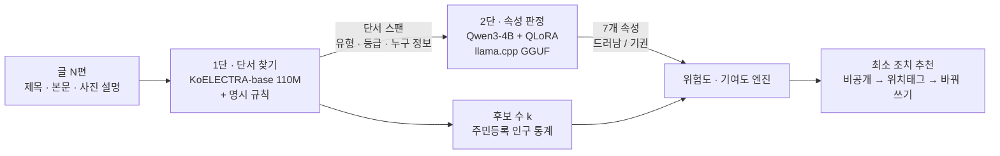

# 파도풀 — 공개 게시글 누적·결합에 따른 재식별 위험 자가진단 및 보호조치 추천 시스템

**KISIA 2026 AI 보안기술개발 · 개인정보 트랙 3팀** · 2026-08-17 ~ 11-08 (12주) · 담당 멘토 권영길

> 이름도 주소도 쓰지 않은 글이 쌓이면 나이·성별·사는 곳·직장·가족이 드러난다.
> 파도풀은 **내 글이 얼마나 나를 특정하는지 이용자 기기 안에서 진단하고**,
> **가장 적은 부담으로 위험을 줄이는 조치**를 추천한다.

**[▶ 시연 영상 (약 6분)](https://youtu.be/1espV-Mg_S0)** — 가상 SNS Veilo와 파도풀 분석기. 등장 계정은 모두 합성 인물이고 실존 개인과 관계없다.

---

## 문제 — 한 편씩은 평범한 글

```
야간 3일차, 퇴근길            → 교대 근무
마흔다섯인데 회복이 예전 같지 않음  → 40대 중반
공단 정문까지 차로 십오 분         → 공단 근처 거주
아들 중간고사 기간이라 문을 살살    → 중학생 자녀
```

글 하나만 보면 신상 정보가 없다. 그런데 이 단서들을 합치면 **같은 조건의 사람이 약 783명**으로 좁혀진다(시연 계정 `3교대인생` · 합성 인물).

주제를 정하기 전 사전 실험에서 합성 인물 한 명의 글을 늘려 가며 LLM에게 신상을 추론시켰다.

| 투입 글 수 | 1편 | 5편 | 10편 | 19편 |
|---|---:|---:|---:|---:|
| 추론에 성공한 속성 | 4/7 | **7/7** | 7/7 | 7/7 |
| 재식별 위험도 (0~100) | 26.7 | 69.2 | 71.9 | **79.7** |

- **5편이면 7개 속성이 모두 드러난다.** 위험은 글 하나가 아니라 글이 쌓이고 결합하는 데서 생긴다.
- 기존 도구 3종(정규식 · Presidio · 한국어 NER)은 단서 문장 967개 중 **47.3%** 를 모두 놓쳤다. 「마흔다섯」 같은 명시 정보만 잡고, 「중간고사」「공단 정문」 같은 암묵 단서는 보지 못한다.
- 선행 연구(Staab et al., ICLR 2024)는 LLM이 공개 글에서 작성자 속성을 최대 85.5% 정확도로 추론함을 보였다. 다만 위협을 실증하는 데 그쳤고, 개인이 직접 점검하고 줄이는 방법이나 한국어 글은 다루지 않았다.

기업은 개인정보 영향평가(개인정보 보호법 제33조)로 위험을 점검하지만, **개인에게는 그런 수단이 없다.** 파도풀은 그 빈자리를 겨냥한다.

---

## 무엇을 만들었나

| | 기능 | 내용 |
|---|---|---|
| ① | **실시간 점검** | 글을 쓰는 동안 직업·지역·가족·성별 단서를 종류별 색으로 표시하고, 후보 인원이 얼마로 좁혀지는지 보여 준다. 누구 정보인지 불분명한 단서는 점선으로 표시하고 계산에서 뺀다 |
| ② | **계정 진단** | 지금까지 쓴 글 전체를 묶어 7개 속성(나이 · 성별 · 거주지 · 직장 · 가족 · 통근 · 소득)별로 드러났는지 판정한다. 같은 조건의 사람 수와 위험도(0~100)를 보여 주고, 판정 근거를 단서 단위로 펼친다. 「내 얘기 아님」을 누르면 그 단서를 빼고 다시 센다 |
| ③ | **최소 조치 추천** | 위험에 크게 기여하는 글부터 골라 **부담이 적은 조치부터** 추천한다 — 글 몇 편 비공개 → 위치태그 삭제 → 바꿔 쓰기. 조치별 예상 효과를 미리 보여 준다 |

- **분석은 이용자 기기 안에서만 돈다.** 프라이버시 위험을 검사한다고 글을 외부 서버로 보내면 그 도구가 곧 침해가 되기 때문이다. 시연 빌드에서 분석 중 외부 서버로 나간 요청은 **0건**이다([동결 재검증](docs/evidence/freeze-W11.md)).
- 화면은 따로 두지 않고 가상 SNS **Veilo**의 글쓰기 화면과 「내 글 점검」 메뉴 안에 넣었다. 실제 플랫폼에 붙일 때의 형태를 그대로 보여 주기 위해서다.

---

## 어떻게 동작하나



**1단 — 단서 찾기.** KoELECTRA-base를 21개 라벨(10개 유형 × B/I + O)의 토큰 분류로 학습했다. 찾은 단서마다 유형, 등급(명시 · 암묵 · 추론), 누구 정보인지(본인 · 타인 · 불분명)를 붙인다. 임계값 0.7에 명시 정보용 규칙을 더했고, CPU에서 글 한 편당 중앙값 160.5ms로 돈다.

**2단 — 속성 판정.** 1단 결과를 프롬프트로 묶어 Qwen3-4B(QLoRA r16)가 7개 속성마다 「드러남」 또는 「기권」을 판정한다. 근거가 약하면 기권하도록 학습해서, 아무 글에나 겁을 주지 않는다. llama.cpp GGUF(Q8_0 + LoRA)로 실행하고, GPU가 없는 PC에서는 같은 기준의 규칙 판정으로 대신한다.

**후보 수와 위험도.** 행정안전부 주민등록 인구 통계(읍면동 × 5세 구간 × 성별, 152,166행)에 단서 조건을 걸어 「같은 조건에 해당하는 사람 수」를 센다. 전체 인구 5,108만 명이 글 한 편의 단서만으로 약 4,973명까지 줄어드는 식이다. 위험도는 속성별 판정에서 따로 계산하고, 글마다 위험에 얼마나 기여하는지를 닫힌 식으로 구한다.

**데이터 — 전량 합성.** 실제 사람의 글을 모으지 않고 가상 인물 115명의 블로그 글 3,092편을 만들었다. 단서를 직접 드러내지 않게 쓰고(✕ 「자동차부품 회사에 다닙니다」 → ○ 「완성차 공장 출장이 잦아서 피곤하네요」), 신상과 무관한 일상 글을 70~80% 섞었다. 정답 라벨은 교사 모델로 초안을 만든 뒤 437편을 사람이 직접 검수했고, 159편은 교사 라벨을 보지 않은 채 따로 라벨링했다. 최종 시험셋은 239편 · 단서 358개다.

---

## 결과

**필수 지표**

| 지표 | 목표 | 결과 | |
|---|---|---:|:---:|
| 명시 단서 탐지 F1 | ≥ 0.80 | **0.6738** | △ 목표의 84% |
| 글 1건 탐지 시간 (CPU) | < 300ms | **160.5ms** | ✓ |
| 조치 3단계 위험도 감소 (인물별 평균) | −54 ~ −61% | **−59.2%** (평균 위험 17.7 → 6.7) | ✓ |

**목표 지표**

| 지표 | 목표 | 결과 | |
|---|---|---:|:---:|
| 위험도와 LLM 추론 성공의 순위 상관 (Spearman ρ) | ≥ 0.7 | **0.813** | ✓ |
| 로컬 모델 판정 일치도 (대형 LLM 기준) | ≥ 0.8 | **0.853** | ✓ |
| 기존 도구 대비 추가 탐지 | > 0 | **58.77%** | ✓ |
| 최적 조치 대비 추가 부담 (중앙값) | ≤ 15% | **0%** | ✓ |
| 암묵 단서 탐지 F1 (사람 간 일치도 대비) | ≥ 80% | **105%** (0.4668) | ✓ |

**도전 지표** — 적대적 회피 후 재현율 하락 −40%p(목표 ≤ 15%p) · Triage 토큰 절감 −51.9%(목표 70%+). 둘 다 미달이라 한계로 남겼다.

- 위험도 40점을 넘던 가상 인물 49명 중 **48명**이 추천 조치만으로(대부분 글 1~3편 비공개) 권장 기준 아래로 내려갔다.
- 시연 계정은 추천 조치를 모두 적용하면 위험도가 **57.1 → 29.3**(예상)으로 내려간다.

<sub>명시 F1은 11/5 교체 모델(수정 KoELECTRA)을 관례를 맞춘 보수 수정 정답(계약 v1.5)으로 잰 proxy 값이다. 정답 기준을 정한 경위는 [DEC-018](docs/decisions.md) · [DEC-019](docs/decisions.md)에 있다. 나머지 지표는 11/2 최종 측정([#404](../../pull/404) · [러너](experiments/bench/README.md))이다.</sub>

---

## 문제를 풀어 간 과정

| 문제 | 해결 | 결과 |
|---|---|---|
| 2단 모델이 입력 단서를 빠뜨린다 | 입력 형식을 바꾼 v2 어댑터로 다시 학습 | 입력 충실도 **0.748 → 0.995** ([DEC-012](docs/decisions.md)) |
| 기여도 근사 계산이 정답과 어긋난다 | 근사를 닫힌 식으로 바꾸고 정답 데이터를 다시 생성 | 정답과 순위 상관 **ρ = 1.0** ([#352](../../pull/352) · [#392](../../pull/392)) |
| 1단이 단서가 아닌 말을 단서로 잡는다 | 판정셋으로 검증한 정밀도 규칙 추가 | 오탐 **1,248 → 1,171건** ([#397](../../pull/397) · exp42) |
| 2단 정밀 판정이 느리다 (계정당 약 1분) | 같은 모델을 GGUF로 변환해 실행 · 판정 804/805칸 일치 | 정밀 판정 중앙값 **67.2 → 27.1초** ([DEC-017](docs/decisions.md)) |

실험 기록(exp01 ~ exp45)은 [experiments/](experiments/)에, 방향을 바꾼 결정 19건은 [docs/decisions.md](docs/decisions.md)에 남아 있다.

---

## 한계와 다음 단계

| 지금의 한계 | 다음 단계 |
|---|---|
| 명시 F1이 목표 0.80에 못 미친다. 오탐이 많고(정밀도 0.62), 정답 관례에 공백이 있었다 | 정답 기준을 다듬고 반례 데이터를 보강 |
| 긴 글은 탐지가 1초를 넘는다 (p95 약 1.05초) | 긴 글을 나눠 처리 · CPU 가속 |
| 실제 글에서는 해시태그 · 가게 · 숙소 이름 · 붙여 쓴 표현의 경계를 놓친다 | 해시태그 · 상호명 인식 |
| 실제 글 검증이 허락받은 블로그 1개 계정 120편뿐이다 (AI 판독 정답 기준 1단 F1 0.464 → 0.649) | 동의 기반 실제 글 검증 확대 |
| 단서를 다른 표현으로 바꿔 숨기면 재현율이 떨어진다 (15/20 → 7/20) | 바꿔 쓴 표현 · 초성까지 학습 |
| 네이버는 본인 글을 가져오는 공식 API를 제공하지 않는다 | 플랫폼별 수집 어댑터 설계 |

**활용 방안**

1. **기업 · 기관 중심이던 재식별 위험 평가를 개인으로.** 개인이 자기 게시글로 직접 점검한다.
2. **한국어 준식별자 벤치마크.** 데이터가 전량 합성이라 공개할 수 있고, 다른 탐지 모델을 평가하는 기준으로 쓸 수 있다.
3. **게시 전 경고.** 플랫폼의 글쓰기 화면에서 게시 전에 단서와 결합 위험을 안내한다.

---

## 팀

| 역할 | 이름 | 맡은 일 |
|---|---|---|
| 팀장 · PM · 2단 추론 · 조치 | 박재현 | 2단 판정 모델 학습 · 조치 추천 엔진 · 교사 라벨 생성 · 일정 · 통합 관리 |
| 특정성 · 누적 | 신정현 | 인구 · 지명 사전 구축 · 위험도 · 기여도 계산 · 블라인드 정답 라벨링 · 시연 영상 |
| 데이터 리드 | 이은선 | 합성 데이터 설계 · 라벨 규칙 작성 · 라벨링 도구 · 라벨 일치도(IAA) 측정 |
| 시스템 · 컴플라이언스 | 이지희 | 가상 SNS · 웹앱 구현 · 외부 요청 0건 검증 · 개인정보 보호법 매핑 · 처리방침 |
| 1단 탐지 | 최진필 | 1단 탐지 모델 학습 · 기존 도구 3종 비교 · CPU 탐지 시간 측정 · 최종 성능 측정 |

| 기간 | 단계 |
|---|---|
| M1 · 8/17 ~ 9/6 | 기반 구축 — 계약 6종 · 합성 인물 설계 · 사전 실험 |
| M2 · 9/7 ~ 10/4 | 모델 v1 · 기여도 엔진 |
| M3 · 10/5 ~ 10/18 | 조치 기능 |
| M4 · 10/19 ~ 11/8 | 완성 · 동결(11/1) · 최종 측정(11/2) · 1단 교체 · 2단 GGUF(11/5) · 제출 |

주차별 진행은 `w01` ~ `w11` 태그로 비교할 수 있다(w03 없음).

---

## 저장소 구조

```
KISIA_Project/
├─ src/kopl/
│  ├─ c1_span/           1단 단서 탐지 (KoELECTRA + 규칙)
│  ├─ c2_specificity/    후보 수 k · 위험도 엔진
│  ├─ c3_contribution/   글별 기여도 (닫힌 식)
│  ├─ c4_stage2/         2단 속성 판정 (Qwen3-4B · 규칙 폴백)
│  └─ c5_corpus/         합성 코퍼스 생성 · 교사 라벨 · 검증기
├─ apps/
│  ├─ sns/               가상 SNS Veilo
│  └─ analyzer/          파도풀 분석기 (FastAPI)
├─ data/
│  ├─ corpus/v0/         합성 인물 115명 · 글 3,092편 · 정답 라벨 · train/test 분리
│  ├─ realism/cards/     리얼리즘 카드 18장
│  └─ dict/admin/        행정구역 · 인구 사전
├─ experiments/          실험 exp01 ~ exp45 · bench/ 최종 측정 러너
├─ docs/
│  ├─ overview.md        프로젝트 배경과 설계 개념
│  ├─ contracts/         모듈 간 계약 6종 (라벨 스키마 등)
│  ├─ decisions.md       결정 기록 DEC-001 ~ 019
│  ├─ evidence/          동결 재검증 · 외부 요청 0건 증빙
│  ├─ roles/             역할별 12주 매뉴얼
│  └─ privacy-policy.md · compliance-mapping.md
└─ models/registry.md    모델 체크포인트 등록부 (가중치는 저장소에 없음)
```

## 로컬에서 실행하기

```powershell
pip install -r requirements.txt

# 터미널 1 — 가상 SNS Veilo (http://localhost:3000)
$env:PADO_BASE="http://localhost:8000"
python apps/sns/app.py

# 터미널 2 — 파도풀 분석기 (http://localhost:8000)
$env:SNS_PUBLIC_URL="http://localhost:3000"
$env:ENGINE_MODE="real"
$env:STAGE2_MODE="rules"
$env:PYTHONPATH="src"
python -m uvicorn apps.analyzer.server:app --port 8000
```

- 1단 · 2단 모델 가중치는 저장소에 포함하지 않는다. 체크포인트 해시는 [models/registry.md](models/registry.md)에 있다.
- `STAGE2_MODE=rules`는 GPU 없이 2단을 규칙 판정으로 돌린다. 시연 빌드에서 규칙 · 모델 두 경로의 위험도 · 사람 수 · 추천은 계정 11개 모두 같았다.
- 협업 규칙은 [CONTRIBUTING.md](CONTRIBUTING.md), AI 도구 작업 규범은 [AGENTS.md](AGENTS.md)에 있다.

---

<sub>이 저장소의 글 · 인물은 모두 합성이며 실존 개인과 관계없다. 실제 사람의 글은 저장소에 넣지 않는다([RULES-DO-NOT](docs/RULES-DO-NOT.md)). 12주간 주차별 실행 문서로 쓰던 이전 README는 `w11` 태그와 git 기록에 남아 있다.</sub>
