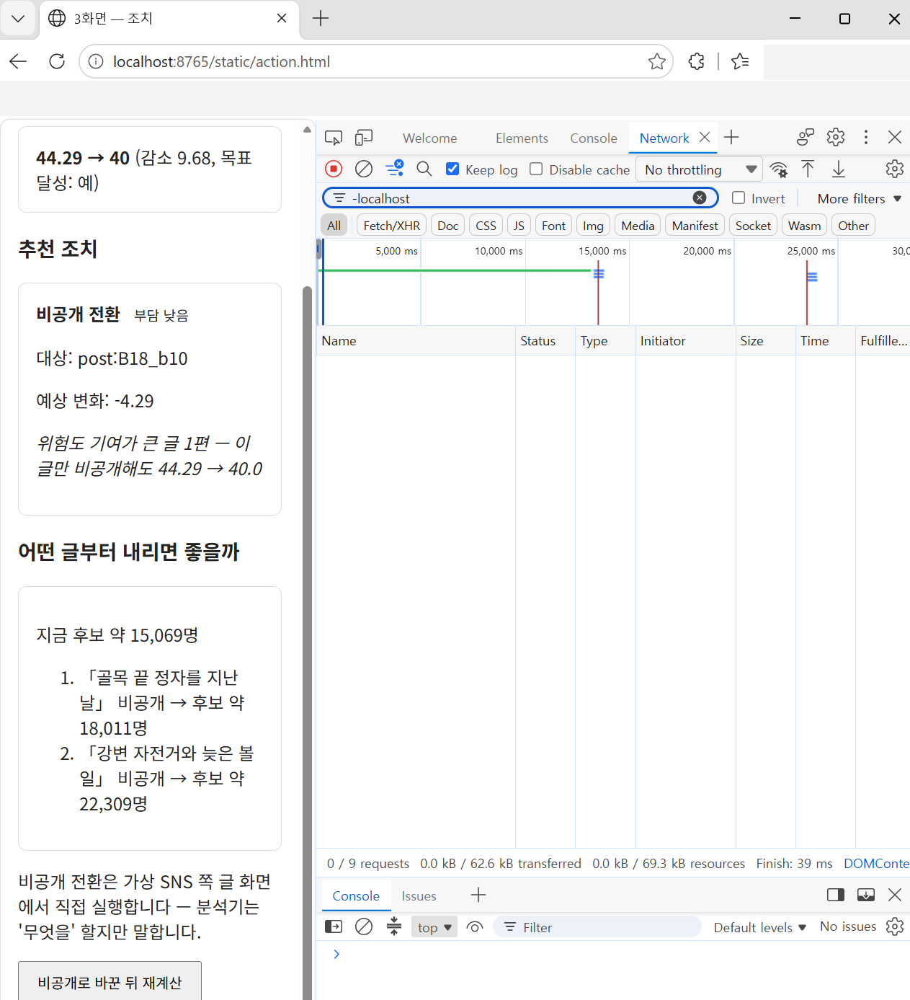

# 외부 요청 0건 — W8 (실제 엔진 전부 연결 후)

> 근거: [e-integration.md §5](../roles/howto/e-integration.md) 「교체할 때마다 네트워크 탭을 다시 본다」 · E-system.md 성공 판정 기준
> 확인: 2026-10-07 · E · 로컬 Windows 11 · CPU · `main` (#291 1단 · #308 C2·C3 · #299 2단 머지 후)
> 실행: `ENGINE_MODE=real` · 1단 v1 체크포인트(`v1_lr5e-5/checkpoint-epoch-10`) · 2단은 GPU 없음 → 규칙 폴백 · Veilo(`apps/sns`) 로컬

W5 캡처 이후 엔진 네 개가 전부 목에서 실제로 바뀌었다. 브라우저 네트워크 탭은 **브라우저가 보낸 요청만** 보여서, 모델 로딩처럼 **서버(파이썬)가 하는 통신**은 따로 확인했다.

## ① 브라우저 — 네트워크 탭



절차는 §5 그대로: F12 → Network → Preserve log(Edge 「Keep log」) → Clear → 스캔(`u_00ceeab4df70`) → 진단 → 조치 → 필터 `-localhost` → **목록 비어 있음**

하단 **`0 / 9 requests`** — 스캔·진단·조치 동안 요청 9건이 있었고, localhost 를 뺀 요청은 0건이다. (캡처의 즐겨찾기 줄은 가렸다. 조치 화면은 #319 머지 전 `main` 이라 「감소 9.68」에 % 가 없다)

## ② 서버 — 분석기 프로세스가 연 TCP 연결

스캔 2회(`u_00ceeab4df70` 30편 · `u_40ef42660c42` 18편) 동안 분석기 프로세스의 연결을 0.2초마다 모아 중복을 뺐다 (PowerShell `Get-NetTCPConnection -OwningProcess <분석기 PID>`).

| 원격 주소 | 상태 | 무엇 |
|---|---|---|
| `127.0.0.1:*` (4개) | Established | 브라우저·요청 ↔ 분석기 |
| `::1:3000` | SynSent | 분석기 → Veilo 내보내기 API (같은 PC) |
| `0.0.0.0:0` · `:::0` | Listen · Bound | 분석기 자신의 대기 소켓 |

**외부 주소 연결: 0개**

## ③ 모델 로딩 — 허브 접속 금지 상태에서 기동

```bash
HF_HUB_OFFLINE=1 TRANSFORMERS_OFFLINE=1 ENGINE_MODE=real PYTHONPATH=src \
  python -c "from apps.analyzer import engines as e; print(e.detect_spans({'post_id':'net_t1','body':'남편이 판교에서 개발자로 일해요.'}))"
```

→ 로드·탐지 정상 (35.2초 · `남편이`/SEX 탐지). 1단 체크포인트는 `local_files_only=True` 로만 읽고(#291), 허브 접속을 막아도 기동한다 = **가중치를 인터넷에서 받지 않는다.**

## ④ GPU 경로 — 2단 Qwen3-4B + QLoRA 어댑터 (10/7 · D 추가)

> 확인: 2026-10-07 · D · 로컬 Windows · **RTX 3060** · `main` + [#320](../../../../pull/320) · `ENGINE_MODE=real` · `STAGE2_MODE=model` · 1단 v1 체크포인트 · 2단 `experiments/exp08-stage2-sft/results/adapter`

위 ①~③은 GPU 가 없는 PC 라 2단이 규칙 폴백으로 돌았다. GPU 로 실제 2단 모델을 올리는 경로를 ②와 같은 방식(분석기 프로세스의 연결을 0.2초마다 모음 · D05·B08 각 12편)으로 확인했다.

| 실행 | 2단 | 외부 주소 연결 |
|---|---|---|
| 1회차 (#320 전) | `qwen3-4b-qlora-v1` | **1건 — `3.168.178.31:443` = huggingface.co** (모델 허브) |
| 2~5회차 (#320 전) | 같음 | 0 (재현 안 됨) |
| **#320 후 2회** | 같음 | **0 · 0** |

- 가중치는 `local_files_only=True` 로 로컬에서만 읽는데도 첫 기동 때 허브로 한 번 나갔다 — 라이브러리의 확인 요청으로 보이며 정확한 호출은 재현이 안 돼 특정하지 못했다. **사용자 글이 나간 것은 아니다**
- [#320](../../../../pull/320) 이 실제 모드 시작 때 허브 접속을 기본으로 끈다 (`HF_HUB_OFFLINE` · `TRANSFORMERS_OFFLINE` · 텔레메트리 끄기) — 위 ③ 과 같은 설정을 기본값으로 만든 것
- 그 밖에: `Stage2Output` 스키마 오류 0 · VRAM 최대 3.43GB · 글 12편 기준 사람당 37~45초 (CPU 규칙 경로는 약 5초)

## 한계

- ①~③ 은 GPU 없는 PC 라 2단이 **규칙 폴백**으로 돌았다. GPU 경로는 ④ 에서 따로 확인했다 — **#320 머지 전 main 으로 GPU 경로를 돌리면 허브 연결이 한 번 나갈 수 있다**
- 외부 LLM 호출은 `apps/analyzer/external.py` 한 곳에만 있고 `ALLOW_EXTERNAL_LLM=false` 가 기본값이다 (이번 실행도 기본값)
