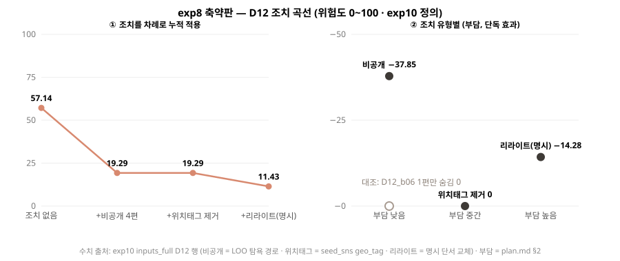

# exp08-actions: exp8 축약판 — 조치 곡선 1종 (D12)

## 무엇을 왜 재는가

8주차 중간점검 양식이 「현재 성능 또는 결과 — 수치·표·그래프」를 강제하는데, 서비스 지표(조치 효과 곡선)는 원래 M3 산출이라 그 시점에 없다. 그래서 **페르소나 1명**으로 조치 유형별 (효과, 부담)을 미리 뽑아 그 칸을 채운다 ([E-system.md §exp8 축약판](../../docs/roles/E-system.md)).

목적은 **「측정 방법이 돌아간다」**를 보이는 것이다. 여러 인물을 다루는 재현은 [exp10](../exp10-action-repro/README.md)(C·D [필수])이 한다.

## 정의 — exp10 과 같다

위험도는 여기서 새로 계산하지 않는다. **exp10 이 합의된 정의로 낸 D12 결과를 읽어** 부담 등급과 함께 그래프로 낸다. 같은 중간점검에 두 실험이 나란히 들어가므로 정의를 맞췄다 (#286 리뷰).

| 항목 | 정의 |
|---|---|
| 조치 순서 | 1) 비공개 → 2) 활동 메타(위치태그 제거) → 3) 리라이트 |
| 비공개 | C3 `leave_one_out` 탐욕 경로 앞 k편 · k_max = round(n×3/19) = 5 |
| 활동 메타 | `scripts/seed_sns.py` 가 붙인 **실제 `geo_tag`** condition 제거 (본문 표현이 아니다) |
| 리라이트 | 명시(explicit) 단서 스팬만 교체 — 본 지표. weaken·remove 는 참고치 |
| 위험도 | C2 `risk_total` — 7축 각 최고 해상도의 평균 (0~100) |
| 부담 | [plan.md §2](../../docs/plan.md) 조치 메뉴 등급 — 비공개 낮음(1) · 활동 메타 중간(2) · 리라이트 높음(3) |

## 설정

| 항목 | 값 |
|---|---|
| 측정일 | 2026-09-30 |
| 페르소나 | D12 — A와 합의 (9/28). 속성 축 9종이라 조치 유형별 차이가 잘 드러남 |
| 데이터 | corpus v0 · D12 **전체 이력 30편 = 검수 골드 10편 + 미검수 교사 라벨 20편** (exp10 전체 이력과 같은 입력). 위치태그는 b06·b17 「울주군」 |
| 입력 | `experiments/exp10-action-repro/data/inputs_full.jsonl` 의 D12 행 · test split 지문 `9662a167` |
| 환경 | Python 3.12 · 외부 라이브러리 없음 (그래프는 SVG 직접 작성) |

## 실행

```bash
export PYTHONIOENCODING=utf-8 PYTHONPATH=src
python scripts/split_train_test.py                       # test 목록 (지문 9662a167)
python experiments/exp10-action-repro/build_inputs.py    # data/inputs_full.jsonl (커밋 안 되는 파일)
python experiments/exp08-actions/run.py
```

산출: `results/metrics.json` · `results/action_curve.svg`

## 결과

**① 누적 적용**

| 단계 | 위험도 |
|---|---|
| 0. 조치 없음 | **57.14** |
| 1. + 비공개 (b04 · b09 · b23 · b13) | **19.29** |
| 2. + 위치태그 제거 | **19.29** |
| 3. + 리라이트(명시) | **11.43** |

리라이트 참고치: weaken 2.86 · remove 0.0

**② 조치 유형별 (부담, 효과)**

| 조치 | 부담 | 단독 효과 | 순서 안 효과 |
|---|---|---|---|
| 비공개 (4편) | 낮음 | **−37.85** | −37.85 |
| 위치태그 제거 | 중간 | **0** | 0 |
| 리라이트(명시) | 높음 | −14.28 | −7.86 |

**대조 — 손으로 고른 한 편:** `D12_b06` 한 편만 숨기면 위험도 57.14 그대로 (효과 **0**).



## 해석

- **D12에서는 비공개가 부담은 가장 낮고 효과는 가장 크다** (−37.85). 기여도 엔진이 고른 4편에 나이(b04 「마흔다섯」)·성별(b09 「형이랑」)·가족(b23 「아들 중간고사」)·소득(b13 「야간수당」)이 **그 글에만** 들어 있기 때문이다.
- **같은 비공개라도 어떤 글을 고르느냐가 전부다.** `D12_b06` 은 단서가 네 개(야간·울주·공단 정문·차 몰고)에 위치태그까지 몰려 있어 위험해 보이지만, 전부 다른 글(b01·b15·b17·b21·b27)에도 같은 축으로 있어서 숨겨도 효과가 0이다. 반대로 기여도가 고른 4편은 글마다 단서가 한두 개뿐인데도 −37.85 다. 「단서가 많은 글을 내리면 된다」는 직관은 틀릴 수 있고, **계정 단위로 다른 글과 겹치는지를 봐야** 비공개 추천이 의미가 있다 — 파도풀이 기여도 엔진으로 글을 고르는 이유다.
- **위치태그 제거는 단독 효과가 0이다.** 태그 「울주군」이 본문(b15 「울주군」)에도 같은 해상도로 있어서 location 축이 그대로다. exp10 전체 이력에서도 87명 중 35명이 같은 현상을 보였다 — 글이 많으면 본문 위치 단서가 태그를 덮는다.
- **리라이트(명시) 효과는 순서에 따라 출처가 바뀐다.** 단독일 때는 나이 「마흔다섯」(b04)을 지워 age 축이 빠지는 −14.28 이다 — 본문 「울주군」(b15)도 지우지만 같은 해상도의 위치태그가 남아 location 은 그대로다. 순서 안에서는 나이가 이미 비공개(b04)로 빠졌고 위치태그도 먼저 지워졌기 때문에, 이번엔 b15 교체가 location 축을 없애 −7.86 이 된다.

## 한계

- **페르소나 1명**이다. 인물별 분포는 exp10 이 다룬다.
- **입력의 3분의 2가 미검수 교사 라벨이다** (30편 중 20편). exp10 전체 이력과 맞추려고 그대로 썼다. 검수 골드 10편만 쓰면 숫자가 달라진다.
- **리라이트는 규칙 모사다.** 명시 단서 condition 을 지운 것이지 실제 문장 재작성이 아니다 (2단 리라이터는 W9).
- **위치태그는 `seed_sns.py` 모사다** (잡담 제외 글의 30%). 실제 사용자 태그 비율에 따라 위치태그 단계 효과가 달라진다.
- 부담은 plan.md 의 3단계 등급이라 수치가 아니라 순서 척도다.

## 변경 이력

- **초판(7555b1f)에서 바꾼 것** — 초판은 ② 활동 메타를 「본문 위치·이동 표현 삭제」로, 비공개 대상을 손으로 고른 `D12_b06` 으로 모델링해 57.1 → 19.3 → 11.4 → 0 이 나왔다. ②는 plan.md §2·sns-minimal-spec 기준 글 바깥 메타데이터라 리라이트와 겹쳤고, 손으로 고른 비공개는 서비스 추천 방식(C3 기여도)과 달라 exp10 과 결론이 반대로 읽혔다. 리뷰(#286)에 따라 exp10 정의로 맞췄고, 초판의 b06 관찰은 위 「대조」로 남겼다.
